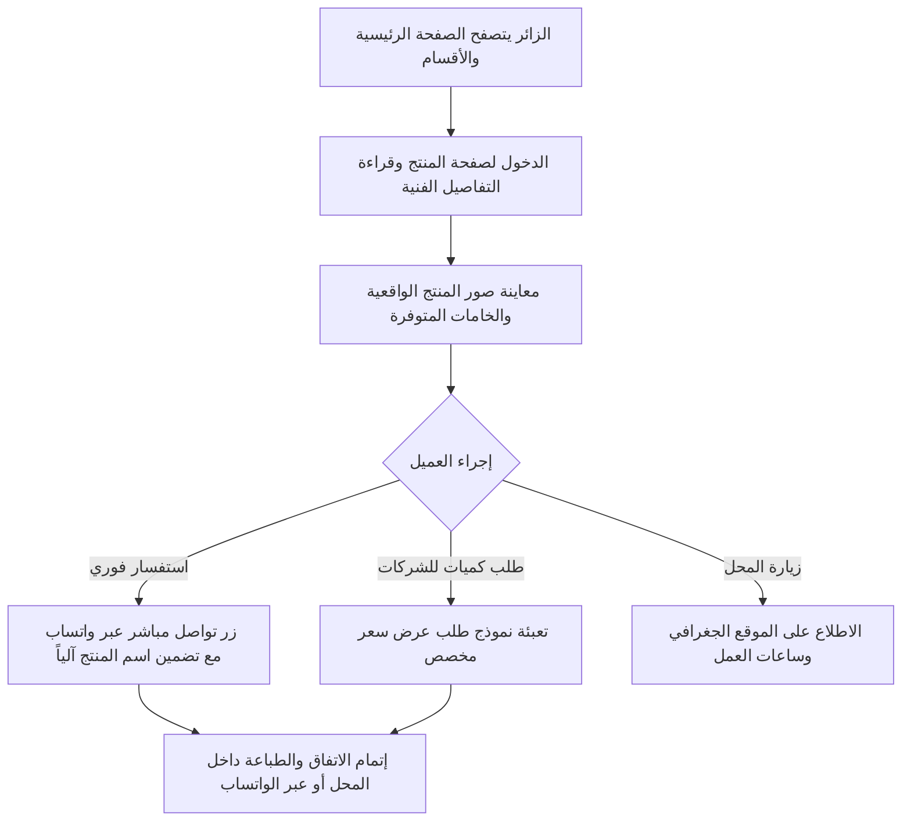

# خطة مشروع موقع كتالوج ومعرض منتجات مطبوعات (نبراس العرب)

وثيقة مواصفات وخطة عمل شاملة لتصميم وتطوير **موقع تعريفي وكتالوج رقمي متكامل** لعرض منتجات وخدمات المطبوعات، مع تفاصيل المواصفات الفنية ونماذج الأعمال، والتحويل السريع للتواصل وطلب التسعير (بدون عمليات بيع أو دفع إلكتروني)، مع معمارية قابلة للتوسع مستقبلاً.

---

## 1. الرؤية ونطاق المشروع (Project Scope & Vision)

* **اسم المشروع:** كتالوج ومعرض نبراس العرب للمطبوعات (`Nebras Al-Arab Print Catalog`).
* **طبيعة الموقع:** منصة عرض رقمية (Product Catalog & Showcase) متخصصة في إبراز جودة المطبوعات، الخامات، والمواصفات الفنية للعملاء.
* **السياسة الأساسية:** **لا توجد سلة مشتريات أو بوابات دفع إلكتروني أونلاين**.
* **الهدف الاستراتيجي:**
  1. عرض منتجات المطبعة وتفاصيلها الفنية وخاماتها وصورها الواقعية بأسلوب احترافي وجذاب.
  2. تسهيل تواصل العميل الفوري عبر **الواتساب المباشر** أو **طلب عرض سعر** بضغطة زر لكل منتج.
  3. استعراض معرض الأعمال والمشاريع السابقة لتعزيز ثقة العميل والشركات بجودة التنفيذ.
  4. بناء الموقع بهيكلية معيارية تسهل ترقيته مستقبلاً لمتجر إلكتروني كامل للبيع أونلاين في حال الرغبة دون الحاجة لإعادة بناء المنصة.

---

## 2. رحلة الزائر وتجربة التصفح (Customer Journey)



---

## 3. الميزات والوظائف للواجهة الأمامية (Storefront & Catalog Features)

### 3.1 الصفحة الرئيسية (Landing Page)
* **واجهة بصرية احترافية (Hero Section):** تعكس هوية نبراس العرب مع رسائل تسويقية لأبرز خدمات المطبعة.
* **أقسام المنتجات التفاعلية:** تصنيفات بارزة وسهلة التصفح مع أيقونات وصور عالية الجودة.
* **أبرز المنتجات الأكثر طلباً:** كروت أعمال، بروشورات، رول اب، علب وتغليف، لافتات، أختام، وغيرها.
* **معرض نماذج الأعمال (Portfolio Highlights):** صور وفيديوهات سريعة لمطبوعات نُفذت بالفعل لإبراز جودة القص والتشطيب.
* **شريط إحصائيات وثقة:** عدد سنوات الخبرة، عدد المشاريع المنفذة، أحدث ماكينات الطباعة.
* **دعوة للتواصل السريع (Quick CTA):** أزرار عائمة للتواصل عبر الواتساب والاتصال.

### 3.2 صفحة المنتج وتفاصيله (Product Details Page)
لكل منتج صفحة مخصصة تقدم دليلاً تفصيلياً كاملاً يغني العميل عن كثرة الأسئلة:
* **معرض صور تفاعلي:** استعراض صور عالية الدقة من زوايا متعددة وتفاصيل التشطيب واللمسات الأخيرة.
* **جدول المواصفات الفنية وخيارات التنفيذ (Available Specifications):**
  * **المقاسات المتاحة:** مقاسات قياسية ومقاسات مخصصة.
  * **أنواع وخامات الورق والمواد:** (كوشيه، كرافت، مقوى، فينيل، كانفاس، أكريليك).
  * **خيارات التشطيب والقص:** (سلوفان مطفي/لامع، بصمة حرارية ذهبية/فضية، سبوت يو في، قص ليزر).
  * **أقل كمية مقترحة للطلب (Minimum Quantity).**
* **إرشادات تجهيز ملفات التصميم للعميل:** دقة الألوان المطلوبة (CMYK)، الدقة (300 DPI)، وهوامش الأمان.
* **أزرار الإجراء السريع (Action Buttons):**
  * زر **"استفسار أو طلب عبر واتساب"**: يفتح محادثة واتساب تلقائياً مع نص جاهز يحتوي اسم المنتج ورابطه.
  * زر **"طلب عرض سعر رسمي"**: يفتح نموذجاً مبسطاً وسريعاً لإدخال الكمية والمواصفات المطلوبة.

### 3.3 تصنيفات وأقسام المنتجات (Categories & Filtering)
* تصفح سلس وفلاتر سريعة للأقسام (مطبوعات ورقية ومكتبية، علب وتغليف، لوحات واستندات، هدايا دعائية، هويات تجارية).
* شريط بحث سريع للوصول لأي منتج بالاسم أو الخامة.

### 3.4 معرض الأعمال والمشاريع (Showcase / Portfolio)
* صفحة مخصصة تستعرض المطبوعات والمشاريع التي نفذتها المطبعة مع إمكانية الفلترة حسب نوع المطبوعة (مثل: هويات شركات، فعاليات، مطاعم ومقاهي).

### 3.5 صفحات تعريفية وتواصل (About & Contact)
* **من نحن:** قصة مطبعة نبراس العرب، الرؤية، والالتزام بالجودة والدقة.
* **فروعنا وموقعنا:** خريطة تفاعلية (Google Maps) لموقع المحل، أوقات العمل الرسمية، وأرقام الهواتف.
* **الأسئلة الشائعة (FAQ):** نصائح حول إعداد التصاميم، صيغ الملفات المقبولة، ومواعيد التسليم.

---

## 4. لوحة تحكم الإدارة (Admin Dashboard)

لوحة تحكم خفيفة، سريعة، وسهلة الاستخدام باللغة العربية تمكن إدارة المطبعة من التحكم الكامل في محتوى الموقع:

### 4.1 إدارة المنتجات والأقسام (Products & Categories)
* إضافة، تعديل، وترتيب تصنيفات المنتجات.
* إضافة وتعديل المنتجات مع محرر نصوص منسق لتفاصيل المواصفات.
* رفع صور متعددة لكل منتج مع تحديد الصورة الرئيسية وصور المعرض.
* تفعيل / تعطيل ظهور المنتج بضغطة زر (Active/Inactive).
* وسم المنتجات المميزة (Featured) لتظهر في الصفحة الرئيسية.

### 4.2 إدارة معرض الأعمال (Portfolio Management)
* رفع صور ومشاريع نفذها المحل مؤخراً وتصنيفها لعرضها في معرض النماذج.

### 4.3 إدارة طلبات عروض الأسعار والرسائل (Inquiries & Leads)
* جدول منظم يستعرض كافة طلبات عروض الأسعار والرسائل الواردة من الموقع.
* إمكانية تغيير حالة الطلب (جديد، تم الرد، تم التنفيذ) مع تدوين ملاحظات المتابعة.

### 4.4 إعدادات الموقع والمعلومات العامة (Site Settings)
* تعديل أرقام الهواتف ورقم الواتساب المربوط بأزرار الطلب الفوري.
* ضبط مواعيد العمل وساعات الدوام.
* تعديل رابط الموقع على خرائط جوجل وشبكات التواصل الاجتماعي.

---

## 5. المعمارية التقنية وقابلية التوسع (Technical Architecture)

```
                            ┌────────────────────────────────────┐
                            │    واجهة المستخدم المتجاوبة        │
                            │ (Blade + Tailwind CSS + Alpine.js) │
                            └─────────────────┬──────────────────┘
                                              │
                            ┌─────────────────▼──────────────────┐
                            │          Laravel 11 Core           │
                            │   (Routing, Controllers, Eloquent) │
                            └─────────────────┬──────────────────┘
                                              │
                      ┌───────────────────────┴───────────────────────┐
                      │                                               │
         ┌────────────▼────────────┐                     ┌────────────▼────────────┐
         │     قاعدة البيانات      │                     │     تخزين وسائط الصور   │
         │ (MySQL/PostgreSQL/SQLite)│                    │ (Storage / Public Disk) │
         └─────────────────────────┘                     └─────────────────────────┘
```

### المزايا التقنية:
1. **السرعة العالية وتوافق الجوال:** استخدام **Tailwind CSS** مع **Alpine.js** يضمن تحميل الصفحات بسرعة فائقة على كافة شاشات الهواتف.
2. **تحسين محركات البحث (SEO):** تجهيز وسوم `Meta Tags` و `Open Graph` لكل منتج لمشاركة الروابط بشكل مميز على منصات التواصل والواتساب.
3. **تصميم قابل للترقية (Scalable Design):** بناء جداول المنتجات والتصنيفات بطريقة معيارية تسمح لاحقاً بإضافة جداول الطلبات (`Orders`) وبوابات الدفع والسلة في أي وقت دون كسر الهيكل الحالي.

---

## 6. مخطط قاعدة البيانات المقترح (Database Schema)

| الجدول (Table) | الحقول الأساسية | الوصف |
| :--- | :--- | :--- |
| **`categories`** | `id`, `name`, `slug`, `icon`, `image`, `order`, `is_active` | أقسام المطبوعات الرئيسية والفرعية |
| **`products`** | `id`, `category_id`, `name`, `slug`, `short_description`, `description`, `specifications` (JSON), `featured_image`, `is_featured`, `is_active` | المنتجات وتفاصيل مواصفاتها الفنية |
| **`product_images`** | `id`, `product_id`, `image_path`, `sort_order` | معرض الصور الإضافية لكل منتج |
| **`portfolios`** | `id`, `title`, `client_name`, `image`, `category_id`, `description` | نماذج ومشاريع المطبوعات السابقة |
| **`quote_requests`** | `id`, `product_id`, `customer_name`, `phone`, `email`, `quantity`, `notes`, `status` | طلبات عروض الأسعار الواردة من الموقع |
| **`settings`** | `key`, `value` | إعدادات التواصل، الواتساب، وأوقات العمل |

---

## 7. مراحل التنفيذ والجدول الزمني (Implementation Roadmap)

### المرحلة الأولى: تأسيس لوحة التحكم والبيانات (Foundation & Admin)
* بناء لوحة تحكم الإدارة (Dashboard) باللغة العربية.
* إنشاء جداول قاعدة البيانات للمنتجات، الأقسام، ومعرض النماذج.
* برمجة شاشات إضافة وتعديل المنتجات مع رفع الصور وحفظ المواصفات.

### المرحلة الثانية: تصميم وبرمجة واجهات العرض (Storefront Pages)
* تصميم الصفحة الرئيسية لمتجر نبراس العرب بتصميم عصري وأنيق.
* بناء صفحات الأقسام والمنتجات مع عرض المواصفات الفنية بوضوح.
* ربط زر الواتساب الذكي الذي يولد نص الرسالة تلقائياً باسم المنتج ورابطه.
* بناء معرض الأعمال (Portfolio) وصفحة التواصل وموقع المحل.

### المرحلة الثالثة: نظام طلب عروض الأسعار والتواصل (Leads & Inquiries)
* برمجة نموذج طلب عرض السعر المخصص وإرسال التنبيهات للوحة التحكم.
* تجهيز صفحة شكر ومتابعة فورية للعميل.

### المرحلة الرابعة: ضبط السيو واختبار الاستجابة والإطلاق (SEO, Testing & Launch)
* التأكد من توافق وسرعة الموقع على كافة شاشات الهواتف والأجهزة اللوحية.
* تهيئة وسوم الميتا للظهور في محركات البحث (Google SEO).
* إدخال البيانات الأولية لمنتجات وخدمات مطبعة نبراس العرب وتدريب الإدارة على استخدام اللوحة.

---

## 8. خيار التوسع المستقبلي (Future Scalability)

عندما تقرر المطبعة في المستقبل بدء البيع الإلكتروني المباشر، لن تحتاج لإعادة بناء الموقع، بل يتم فقط تفعيل:
* إضافة سلة التسوق (Shopping Cart).
* بوابات الدفع الإلكتروني (مدى، أبل باي، فيزا).
* نظام رفع ملفات الطباعة مع الطلب.
* شركات الشحن والتوصيل.
